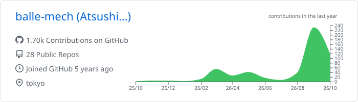
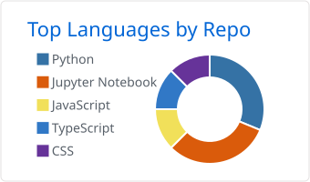
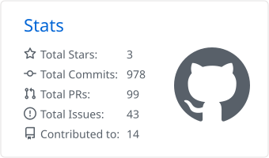
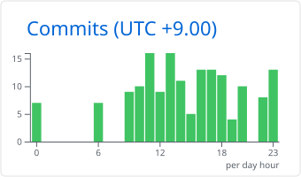

  
  
  
  

#### 🧰 Tech Stack

**Data**

  

**Web / App**

**Infra / Tools**

<!--START_SECTION:lapras-card-->

  
Last Updated on 10/29/2026, 5:03:20 AM

<!--END_SECTION:lapras-card-->

#### 📊 GitHub Stats

  
  

  
  
  

